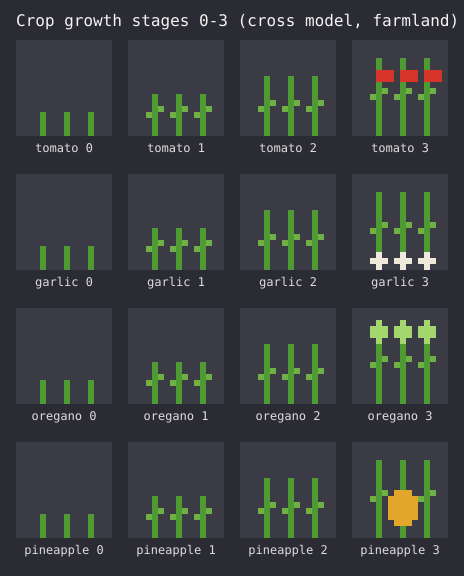
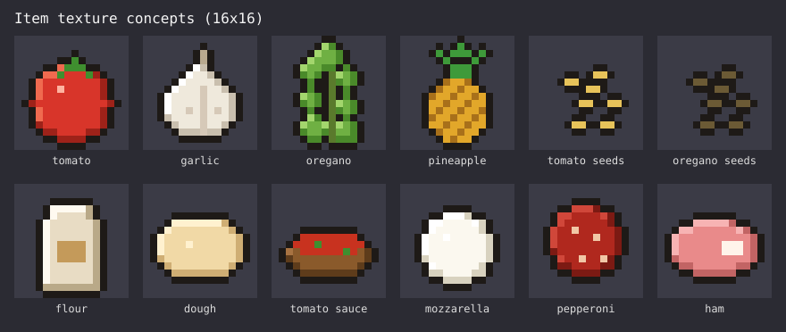
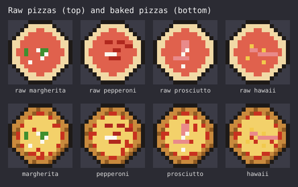
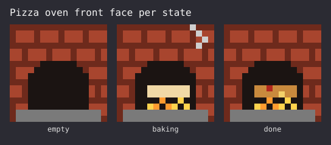

# Foodcraft v1 "Pizza Night": Design

A Minecraft Bedrock add-on for advanced cooking, built by Ravn and Kasper (11) with Claude's help.
v1 delivers one complete loop: find wild plants, farm them, craft ingredients, bake pizza in a pizza oven.

## 1. Goals and constraints

- The kids build it. Claude explains, reviews, and writes the harder script parts with them.
- Platforms: develop and test on Windows. Xbox, PlayStation and Switch players use it through a Realm.
- Every build step ends in something playable.

## 2. Content

### 2.1 Wild plants and crops

| Wild plant | Biomes | Breaking drops | Crop harvest (mature) |
|---|---|---|---|
| Wild tomato | Plains | Tomato seeds | 2–3 tomatoes + 1–2 tomato seeds |
| Wild garlic | Forest | Garlic clove | 2–4 garlic (garlic is planted directly, like potatoes) |
| Wild oregano | Meadow, plains | Oregano seeds | 1–2 oregano + 1–2 oregano seeds |
| Wild pineapple | Jungle | Pineapple crown | 1 pineapple + 1 pineapple crown |

- Each crop has 4 growth stages (0–3), is planted on farmland only, and accepts bone meal.
- Breaking an immature crop drops only its seed item.

### 2.2 Ingredients (crafting table)

| Item | Recipe | Notes |
|---|---|---|
| Flour | 1 wheat | Shapeless |
| Pizza dough | 3 flour + water bucket | Bucket returned empty |
| Tomato sauce | 2 tomato + garlic + oregano + bowl | Shapeless |
| Mozzarella | Milk bucket | Bucket returned empty |
| Pepperoni | Raw porkchop + oregano | Shapeless |
| Ham | Cooked porkchop | Shapeless, gives 2 |

### 2.3 Pizzas

Raw pizzas are crafted at a crafting table. Baked pizzas only come from the pizza oven.

| Pizza | Raw recipe (shapeless) |
|---|---|
| Margherita | Dough + tomato sauce + mozzarella + oregano |
| Pepperoni | Dough + tomato sauce + mozzarella + pepperoni |
| Prosciutto | Dough + tomato sauce + mozzarella + ham |
| Hawaii | Dough + tomato sauce + mozzarella + ham + pineapple |

- Baked pizza restores more hunger and saturation than any vanilla food item.
- Eating raw pizza is allowed and gives Nausea for 10 seconds (intentional joke, keep it).

### 2.4 Pizza oven

- Recipe (shaped): bricks around a furnace, stone along the bottom row.
- States: `empty`, `baking`, `done`, plus the type of pizza inside (`none`, `margherita`, `pepperoni`, `prosciutto`, `hawaii`).

### 2.5 Visual concepts

The images in this section are generated starting points, not final art. Ravn and Kasper redraw each texture in Blockbench. Rules for the final art:

- 16×16 pixels, matching vanilla item size.
- Dark outline around items, as in vanilla.
- Raw and baked versions of a pizza must be easy to tell apart: pale crust and sauce when raw, brown crust and melted cheese when baked.
- Each crop's mature stage shows its produce clearly.

## 3. Architecture

Two packs in this repo:

- **Behavior pack:** items, blocks, recipes, feature rules (wild plant spawning), loot tables, one script module.
- **Resource pack:** textures, oven model, `en_US` and `nb_NO` names, sounds.

| Part | Mechanism |
|---|---|
| Seeds, produce, ingredients, pizzas | Item JSON. Seeds use `minecraft:block_placer`, restricted to farmland. |
| Recipes | Crafting-table recipe JSON (shaped/shapeless) |
| Wild plants | Custom blocks, cross geometry, placed by feature rules per biome, loot table drops |
| Crops | Custom block with `growth` state 0–3. Script custom component grows it on random tick and handles bone meal. |
| Pizza oven | Custom block with states from 2.4. Script custom component handles interaction and the bake timer. Glow and smoke while baking. |

Tools: Blockbench (textures, oven model), VS Code (JSON, script), a Windows test world with development packs linked.

Exact `@minecraft/server` version, block format version, and Windows development pack paths are decided in the implementation plan after checking current Mojang docs.

## 4. Oven behavior

### 4.1 Normal flow

1. Right-click an `empty` oven holding a raw pizza: consume one raw pizza, set `baking` and the pizza type, start glow and smoke.
2. After 10 seconds: set `done`, play a ding sound, show the pizza on the oven.
3. Right-click a `done` oven: give the matching baked pizza, set `empty` and type `none`.

### 4.2 Edge cases

| Situation | Behavior |
|---|---|
| Right-click with anything else | No change. Action bar: "Put a raw pizza in the oven". |
| Right-click while `baking` | No change. Action bar: "Still baking…" |
| Oven broken while `baking` | Drops the oven plus the raw pizza |
| Oven broken while `done` | Drops the oven plus the baked pizza |
| World closed mid-bake | State persists in the block. On load, any `baking` oven finishes 10 seconds after it is next ticked. |
| Pizza left in a `done` oven | Stays indefinitely, never burns |
| Two players click at once | First state change wins. The second click sees the new state. |
| Creative mode | Same flow, raw pizza not consumed |
| Player inventory full on take-out | Baked pizza drops on the ground in front of the oven |

## 5. Build order

Each step is playable before the next starts.

1. Hello pizza: packs load, one tomato item with texture, edible.
2. Ingredients: all produce and ingredient items plus recipes, tested via `/give`.
3. Pizzas: 4 raw, 4 baked, nausea effect.
4. Oven: block, model, script, all edge cases in 4.2.
5. Crops: seeds, growth stages, bone meal, harvest drops.
6. Wild plants: per-biome spawning and seed drops.
7. Polish: Norwegian names, sounds, `.mcaddon` export, Realm test on a console.

## 6. Testing

- Content log (Settings > Creator > Content Log) shows no errors after every change.
- `docs/test-checklist.md`: one line per item, recipe, and oven edge case. Tick off in the test world before a step counts as done.
- Wild plant spawning (step 6) is tested in a newly created world, because features only generate in new chunks.

## 7. Out of scope for v1 (later versions)

- Villagers planting the new crops. Vanilla farmers only plant wheat, carrots, potatoes and beetroot. This needs a script, or a modified copy of the vanilla villager that can break when Minecraft updates and clash with other add-ons.
- Villager trades: the butcher (smoker workstation, the closest vanilla profession to a chef) sells refined ingredients such as tomato sauce and pepperoni at higher prices. The farmer sells raw ingredients. Both require overriding the vanilla trade files for those professions.
- More stations: wok, cooking pot, cutting board, juicer.
- Oven extras: burnt pizza, fuel, multiple pizzas at once.
- Remaining ingredients and recipes from the brainstorm: cheeses (cheddar, Jarlsberg, gräddost), pasta, taco, lasagna, kanelsnurrer, gresskarsuppe, fruits, berries, jam, jelly, chocolate, brownies, noodles, soy products, mustard, chili sauce, and the suggested recipes (bolognese, mac and cheese, taco fredag, wok noodles, vafler, pannekaker, and others).
